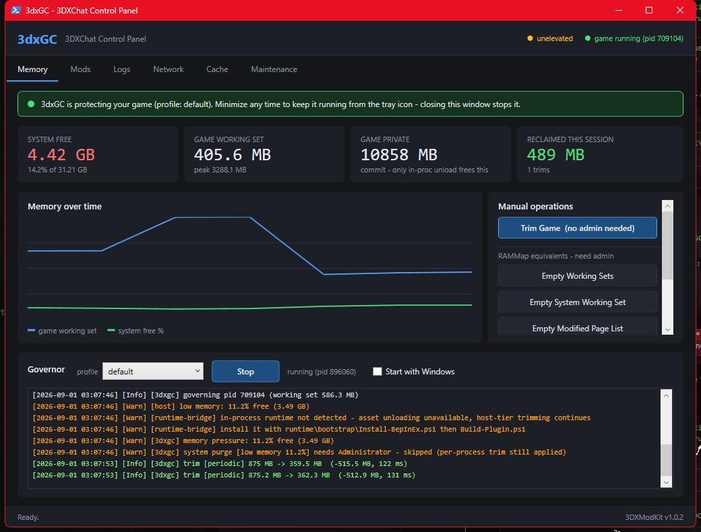

# 3DXModKit

A modular, client-side-only mod framework for **3DXChat** — plus **3dxGC**, a mod that automates what you would otherwise be doing by hand in RAMMap.



Built and tested against:

| | |
|---|---|
| Unity | **2021.3.45f2** |
| Scripting backend | **IL2CPP** (`GameAssembly.dll`, `global-metadata.dat`) |
| Build | 471 (launcher V6) |
| Notable in-process tenants | Vuplex/CEF (`libcef.dll`, 184 MB), Magick.NET, Audio360, OVRPlugin |

---

## Why this exists

There was no mod framework for 3DXChat. What existed:

- **3DXChat Plus** — closed-source, paid, monolithic build. Not extensible.
- **3DXChat Tweaked** — swapped `Assembly-UnityScript.dll`. That is the *pre-IL2CPP* era and does not apply to current builds.
- The wiki's *Plugins and Add-ons* page — mostly standalone external utilities.

No mod loader, no manifest format, no load order, no dependency resolution, no capability model. This is the first.

---

## Client-side only, and enforced

Every mod declares its capabilities in `mod.json`. The loader refuses, unconditionally, anything in these namespaces:

```
net.*                game.protocol.*      game.state.*
account.*            runtime.patch.net*
```

There is deliberately **no config switch to override this**. A mod that asks for network or protocol access does not load:

```
net-sniffer    valid=False  REFUSED capability 'net.socket.read':
                            matches forbidden namespace 'net.' (client-side-only policy)
proto-hack     valid=False  REFUSED capability 'game.protocol.send': ...
```

The same rule is enforced a second time *inside* the game process: `ClientOnlyGuard` vets every Harmony patch target and refuses anything resolving into `System.Net`, `UnityEngine.Networking`, `Photon`, `LiteNetLib`, `Mirror`, `BestHTTP`, and friends. Editing a `mod.json` by hand does not get you past it, because the patch simply never applies.

Nothing in this framework touches the wire, the protocol, or server-authoritative state. It manages memory.

---

## The two tiers, and why both are needed

This is the part that actually matters for your 4 GB idle.

**`EmptyWorkingSet` does not reduce a process's committed memory.** It evicts resident pages to the standby list. They are reclaimable by other processes, but the game still references them, so they fault back in. Measured on this machine during development:

```
javaw   working set 7,989 MB -> 219 MB      (594 MB returned to the system)
        private bytes 14,837 MB -> 14,835 MB   <-- essentially unchanged
```

Minutes later that process was back at 8,087 MB. That is the mechanic, not a bug — and it is why a blind RAMMap timer trades stutter for numbers that do not stick.

| Tier | Runs | Mechanism | Effect |
|---|---|---|---|
| **Host** (external) | Outside the game | `EmptyWorkingSet`, standby/modified-list purges | Lowers **resident** footprint. No game files touched. |
| **Runtime** (in-process) | Inside the game | `Resources.UnloadUnusedAssets()` + `GC.Collect()` | Lowers **committed** memory — actually releases it. |

Only in-process code can free the textures, meshes and audio clips Unity is still holding from rooms and avatars you already left. That is where a multi-GB idle footprint lives. The host tier alone shuffles pages; the runtime tier alone leaves resident junk behind. `runtime-bridge` sequences them: unload first, then trim, so the trim operates on a genuinely smaller process.

The host tier works fine on its own if you never install the runtime.

---

## Leaks no trim can fix

Sometimes the RAM is gone and the game isn't what's holding it. 3dxGC's **leak watch** checks every five minutes and says so in the log:

- **Exited processes the kernel is still holding.** A buggy driver can keep a reference to every process that ever ran. Each one pins about 58 KB of page tables and pool, which no process owns and no RAMMap operation returns. On the machine this was found on, 313,537 of them held 18 GB of a 32 GB PC. 3dxGC counts them from the kernel's `Proc` pool tag (no admin needed) and runs a short leak test to show whether it's still happening: six `whoami.exe` that should be gone within minutes of exiting, checked again four minutes later. Updating the driver to blame stops it growing.
- **Processes that only grow.** An app whose private memory or handle count rises at almost every sample (for example +5 GB/h, or +2,000 handles/h) is reported by name.
- **Background apps get a RAM cap, and Windows holds them to it.** Trimming only asks an app to let go — it pulls the memory straight back the moment it touches it. A cap insists: a hard working-set ceiling the app can't grow past, so past it the app pages against its own limit instead of taking RAM from your game, plus low memory priority so its RAM is the first Windows takes when anything needs some. An app is capped once it has been in the background for a couple of minutes, and the cap lifts within seconds of you switching to it. The app in front (and everything it started), the game, 3dxGC and Windows' own display, input and audio pieces are never capped. Allocations are untouched — a capped app slows down, it never fails to allocate.
  - **Each cap settles at what the app actually uses.** A cap below an app's active memory frees nothing — its pages just bounce through the standby list, which Windows already counts as free — and burns CPU on page faults. So 3dxGC watches each capped process: one paging hard against its cap gets room, one sitting quietly at its cap is pushed a step lower to see whether idle memory goes with it. Your cap is the ceiling; the app gets less whenever it can live with less. On a test app holding 400 MB but using 100, the cap walked down and it settled at about 100 MB with no paging.
  - **Always keep X GB free.** While free RAM is under your target, every allowance tightens a step at a time — but only while that frees RAM. When a step frees nothing (what's left is the game, Windows, drivers and apps' active memory) it holds, and when capped apps start paging heavily it backs off, because squeezing past that point costs CPU and frees nothing. Once there's room again caps relax. The default keeps a quarter of your RAM free.
  - **Per app, from the control panel's Caps tab.** Every app over 100 MB is listed with what it's using now and exactly what's happening to it — capped (and at what), in front, just left, on a call, or under the line. Set its cap in MB, leave it blank for the "any other app" cap, or tick **Never cap**. Save applies within 15 seconds — the governor re-reads caps on every pass, nothing restarts. Your settings live in `config\3dxgc.json`, which updates never touch.
  - **An app's processes share its cap by what each needs.** A busy browser tab takes room from idle ones instead of paging at a fixed slice.
  - **Calls and sound** are spared by default (a capped app mid-call can crackle); untick that to cap everything regardless.
  - Every cap is lifted when the governor stops — including when the control panel stops it.
- **Apps you've left give back what they aren't using.** 30 seconds after an app leaves the front, 3dxGC trims it. Its idle pages go to the standby list, so free RAM goes up at once, and anything the app touches again comes straight back from RAM. It's trimmed again each time it grows back by 64 MB. An app that takes a trim straight back is using that memory, so it's left twice as long each time, up to half an hour. Set the delay (0 turns it off) on the Caps tab. The trim frees what an app isn't using right away; the cap stops it growing back past its limit.
- **While you're away** (3 minutes without input, then every 10 minutes while you stay away), 3dxGC does what RAMMap's Empty menu does, except empty the standby list: every working set, Windows' file cache, the modified list written out, the lowest-priority cache. Emptying standby is left out on purpose. Standby already counts as free (it's part of Task Manager's *Available*), so emptying it frees nothing more; it only throws away the cached copies, and whatever is needed again then comes from disk instead of RAM. It still runs under real memory pressure, and `systemWide.whenIdle.purgeStandby` adds it to the idle sweep too. The game is left alone while it's on screen. Needs administrator.
- **Asking, never doing.** 3dxGC never restarts an app, a service or Windows by itself. When an app in `leakWatch.askToRestart` grows past its line (default: Explorer above 1.5 GB, Discord above 3 GB), or a service there leaks handles (default: `ArmouryCrateService` above 50,000), 3dxGC's prompt card appears in the bottom-right corner — *"Restart Discord? Discord has grown to 3,200 MB of memory…"* — with **Restart** and **Not now**. Press Restart and the control panel restarts it the way it was started (Discord through its own updater, Explorer with its folder windows reopened; a service through Windows' administrator prompt). **Not now** leaves it running and doesn't ask about it again for three days; **Don't ask again** means never for that app; a minute without an answer leaves it running too. The card is 3dxGC's own window rather than a Windows notification, so Do Not Disturb, game mode and full-screen apps can't hide it, and it never takes focus — the game keeps your keyboard and mouse. Because trimming already takes an app's RAM back, it only asks about an app when that isn't enough (free RAM under 15% or Windows' memory commitments over 90%), at most once a day per app, never in the first half hour after 3dxGC starts, and never while the app is on a call. What it asked and what you snoozed are kept in `config\3dxgc.state.json`, so restarting 3dxGC doesn't start asking all over again. No mod can restart anything — only pressing Restart can.
- **Rival optimisers.** If another memory optimiser runs alongside 3dxGC, they fight, so 3dxGC tells you to close one.

Caps, trimming apps you've left, the idle sweep and asking are all off in the conservative profile.

While the kernel is holding more than 4 GB, the RAM-amount trigger stops trimming the game in the foreground. The shortage isn't the game's, and trimming it would only cause stutter.

---

## Install

**[Download `3dxGC-Setup`](https://github.com/Deaeath/3DXModKit/releases/latest)** and run it. It installs for your Windows account only, so installing needs no administrator, and you get:

- **3dxGC in the Start menu**, and on the desktop if you want it, with its own icon on the taskbar.
- **Start with Windows**, on by default, so it's in the system tray from the moment you sign in.
- **An entry in Settings > Apps > Installed apps**, so it uninstalls like any other app. The uninstaller asks whether to keep your settings.

Already running 3dxGC from the zip? Exit it from its tray icon first. Setup brings your settings over (caps, keep-free target, profile) and points Start with Windows at the new copy. You can delete the old folder afterwards.

3dxGC asks for administrator each time it opens, because four of the five RAMMap-equivalent operations need it. **Decline and it still runs.** Per-process trimming and caps need no privileges; you just lose the system-wide purges.

> The installer isn't code-signed, so Windows may say *"Windows protected your PC"* the first time. Click **More info**, then **Run anyway**. Each release's `SHA256SUMS.txt` lists the checksum of every download.

### Without installing

Each release also has `3DXModKit-vX.zip`. Extract the folder anywhere and double-click `3dxGC.exe`. Nothing else to set up: Windows PowerShell 5.1 ships with Windows and is all the host tier needs.

> Extract the folder before running. Launching from inside the .zip leaves Windows' temp copy without the `gui\` and `src\` folders, and the launcher will tell you so.

Prefer git?

```powershell
git clone https://github.com/Deaeath/3DXModKit.git
cd 3DXModKit
.\3dxGC.bat                  # GUI
.\modkit.ps1 status          # command line
```

### GUI

`gui\Start-Gui.ps1` is a WPF control panel with a system tray icon, designed so there is nothing to figure out:

- **Starts governing on its own.** No click required — it launches with your last-used profile (or `default`, the first time) already running.
- **Minimising hides it to the tray**, not the taskbar — the governor keeps running. Closing the window (the X button, or **Exit** in the tray menu) stops it for real.
- **Updates itself.** It checks for a newer release on launch and every six hours. An installed copy downloads the new `3dxGC-Setup` and runs it silently: Setup closes 3dxGC, updates it and opens it again, as it was, without a UAC prompt. A copy run from the zip downloads the zip and swaps its files instead. Either way the download is used only if it matches the release's `SHA256SUMS.txt`. No download-and-reinstall, ever.
- **"Start with Windows"** checkbox (next to the profile picker) so you never have to open it at all — check it once, forget the app exists.
- **Only one copy runs.** Opening it again while it's in the tray tells you so, instead of starting a second governor that would fight the first.

The onboarding banner at the top of the Memory tab always tells you the current state in plain language. That's the whole manual.

Tabs: **Memory** (live graph, manual RAMMap operations, governor + streaming log), **Mods** (validation and the refusal policy), and **Logs / Network / Cache / Maintenance**, which front the scripts from the companion [3DXChat Debug Toolkit](#companion-toolkit) if you have it.

Launch it elevated to enable the four system-wide operations.

```powershell
.\gui\Start-Gui.ps1 -Minimized                       # start straight to tray
.\gui\Start-Gui.ps1 -ToolkitPath "D:\path\to\toolkit"
```

Auto-update is on by default. To turn it off, set `"AutoUpdateEnabled": false` in `config\gui-settings.json` (created on first run) — there's no UI toggle for this by design; it's a power-user escape hatch, not something most people should need.

### Command line

### Host tier (no game files touched)

```powershell
.\modkit.ps1 run -ProfileName default
```

Run the shell **as Administrator** to unlock the system-wide purges. Without elevation, per-process trimming still works and the system-wide operations report themselves as skipped rather than failing silently.

### Runtime tier (adds files to the game folder)

The runtime is a BepInEx plugin, so installing it adds a few files next to `3DXChat.exe`:

- Every added file is recorded, and `Uninstall-BepInEx.ps1` puts the folder back exactly as it was.
- A game update or launcher repair can restore the original files, which just removes the install — run the installer again.
- Like the rest of 3DXModKit it is client-side only: it asks the game to free memory and never touches the network or the chat protocol.

```powershell
cd runtime\bootstrap
.\Install-BepInEx.ps1 -GamePath "C:\...\3DXChat\Game"
# launch the game once, let it idle at the login screen while interop assemblies generate
.\Build-Plugin.ps1  -GamePath "C:\...\3DXChat\Game"
```

Every file added is recorded, so revert is exact:

```powershell
.\Uninstall-BepInEx.ps1 -GamePath "C:\...\Game" -BackupPath "..\..\backups\<timestamp>"
```

---

## Commands

```
.\modkit.ps1 status              environment, memory, game state
.\modkit.ps1 list                installed mods
.\modkit.ps1 validate            validate every manifest
.\modkit.ps1 caps                capability catalog + refusal policy
.\modkit.ps1 profiles            available modpacks
.\modkit.ps1 empty -Target Game  fire a RAMMap operation now
.\modkit.ps1 run -ProfileName default
.\modkit.ps1 watch               live memory readout
```

`empty` targets map 1:1 onto RAMMap's menu:

| `-Target` | RAMMap equivalent | Needs admin |
|---|---|---|
| `Game` | *(per-process, not in RAMMap)* | no |
| `WorkingSets` | Empty Working Sets | yes |
| `SystemWorkingSet` | Empty System Working Set | yes |
| `ModifiedList` | Empty Modified Page List | yes |
| `Standby` | Empty Standby List | yes |
| `LowPriorityStandby` | Empty Priority 0 Standby List | yes |
| `All` | all five, in menu order | yes |

---

## Profiles (modpacks)

A profile is a named set of enabled mods plus their config.

| Profile | Behaviour |
|---|---|
| `default` | Adaptive. Unload + trim when backgrounded, minimised, or idle, and whenever the game passes 4 GB of RAM or free RAM drops under 1.5 GB. System purges only when critical. |
| `aggressive` | Closest to RAMMap-by-hand. Short debounces, periodic sweeps, trims at 3 GB, purges whenever RAM dips. Expect occasional hitching. |
| `conservative` | Never touches anything while the game is in use. No system purges. |
| `host-only` | External tier only. Nothing written to the game directory. |

---

## Measured

Real numbers from this machine, driven end-to-end through the framework:

```
[host]            low memory: 8.3% free (2.58 GB)
[3dxgc]           trim [low memory 8.3%] 8088.8 MB -> 54.4 MB  (-8034.4 MB, 1389 ms)
```

---

## Writing a mod

See [docs/WRITING-MODS.md](docs/WRITING-MODS.md). The short version — a mod is a directory with `mod.json` and an entry script that returns a hashtable:

```powershell
@{
    Initialize = {
        param($ctx)
        $ctx.On('game.minimized', { param($e) $ctx.TrimGame() }.GetNewClosure())
    }
    Shutdown = { param($ctx) }
}
```

`$ctx` only carries the methods your declared capabilities entitle you to. Omit `memory.trim.system` and `PurgeStandbyList` is not on the object at all — the manifest is the access boundary, not documentation.

---

## Layout

```
3DXModKit/
├── 3dxGC.bat                     double-click launcher (self-elevating); releases add 3dxGC.exe
├── modkit.ps1                    CLI
├── 3DXModKit.psm1                module entry point
├── gui/
│   ├── Start-Gui.ps1             WPF control panel + system tray
│   └── MainWindow.xaml           layout
├── src/
│   ├── Native/MemoryApi.cs       P/Invoke: all 5 RAMMap ops, telemetry, leak diagnostics
│   ├── Core/Manifest.ps1         schema, capability model, validation
│   ├── Core/Resolver.ps1         discovery, dependency graph, load order
│   ├── Core/Config.ps1           layered config (defaults < profile < user)
│   └── Host/Runtime.ps1          event bus, scheduler, capability-gated context
├── mods/
│   ├── 3dxgc/                    adaptive working-set governor (3dxGC)
│   ├── profile-studio/           companion status + opener for 3DX Profile Studio
│   ├── radio-streamer/           companion status + launcher for 3DX Radio Streamer
│   ├── world-editor/             companion status + launcher for 3DX World Editor
│   └── runtime-bridge/           host <-> in-process bridge
├── runtime/
│   ├── bootstrap/                BepInEx install / build / uninstall
│   └── src/ModKit.Runtime/       BepInEx 6 IL2CPP plugin
├── profiles/                     modpack definitions
├── build/                        release build: installer script, launcher source, icon
└── logs/
```

To build a release, run `.\build\Build-Release.ps1`. It needs [Inno Setup 6](https://jrsoftware.org/isinfo.php) and writes the zip, the installer and `SHA256SUMS.txt` to `dist\`.

---

## Companion apps

Three separate apps pair with the modkit. None of them runs inside the game or changes its files. The control panel's **Mods** tab has an **Open** and an **Install / Update** button for each:

| App | What it is | Open |
|---|---|---|
| [3DX Profile Studio](https://github.com/Deaeath/3dx-profile-studio) | A Word-style editor for your profile and gift texts, with an AI writer that takes a key from any provider | In your browser. If it isn't installed yet, you can install it or use [the online version](https://deaeath.github.io/3dx-profile-studio/) |
| [3DX Radio Streamer](https://github.com/Deaeath/3dx-radio-streamer) | Airs music to your own Shoutcast or Icecast station for a room radio | Starts the app |
| [3DX World Editor](https://github.com/Deaeath/3dx-world-editor) | Edits `.world` files in 3D with the game's real models, without the in-game editor's lag | Starts the app, which opens the editor in your browser. If it isn't installed yet, you can install it or use [the online version](https://deaeath.github.io/3dx-world-editor/) |

**Install** downloads the latest GitHub release, checks it against the release's `SHA256SUMS.txt` and asks once more before installing. It runs in its own window, so you can see every step. The same scripts work on their own: `mods\profile-studio\bootstrap\Install-ProfileStudio.ps1`, `mods\radio-streamer\bootstrap\Install-RadioStreamer.ps1` and `mods\world-editor\bootstrap\Install-WorldEditor.ps1`.

Each app also has a mod that reports on it when the game starts.

### Profile Studio mod

```
[profile-studio]  3DX Profile Studio v1.0.0 is installed: ...\3DX Profile Studio.html
```

Set `openWithGame` to `true` in its config to open the editor whenever the game starts. This uses `ui.open.companion`, which only opens an existing `.html` page outside the game directory.

### Radio Streamer mod

```
[radio-streamer]  3DX Radio Streamer is installed (...) and running.
[radio-streamer]  Station 'My Radio' on Listen2MyRadio, airing one app only (Spotify.exe).
[radio-streamer]  Room radio URL: http://109.169.23.84:17263/;
```

Paste that URL into the room's radio. For Shoutcast v1 servers (Listen2MyRadio's free plan), it ends in `/;` so the server sends audio rather than its status page.

- **Starting it with the game:** set `launchWithGame` to `true` in the mod's config. This uses `process.launch.companion`, which only starts an existing `.exe` outside the game directory.
- **Client-side only:** the streaming happens inside the separate app. The mod never opens a socket and never logs the station password from the app's settings.

### World Editor mod

```
[world-editor]  3DX World Editor v1.0.0 is installed (...) and not running.
[world-editor]  Game models read on 2026-10-08; delete ...\3DXWorldEditor\assets after a big game update to read them again.
```

The editor reads the game's data files (read-only) the first time it opens, to show the real models, and keeps its copy in `%LOCALAPPDATA%\3DXWorldEditor`. Set `launchWithGame` to `true` in the mod's config to start it with the game (`process.launch.companion`, an existing `.exe` outside the game directory only).

---

## Companion toolkit

The Logs, Network, Cache, and Maintenance tabs shell out to the scripts from the 3DXChat Debug Toolkit. Point the GUI at it with `-ToolkitPath`, or ignore those tabs — nothing else depends on them.

---

## Known constraints

- **Trimming is not free.** Every evicted page is a hard fault later. `conservative` exists for a reason.
- **Controlled Folder Access** will block 3DXModKit from writing its `logs\` and `config\` if you place it under `Documents\`, `Pictures\`, or another protected folder. CFA reports this as a misleading *"Could not find file"* rather than access-denied. Either install elsewhere or allow PowerShell through Defender.
- **Building the runtime plugin needs a .NET SDK ≥ 5.0** (for `netstandard2.1`). The host tier needs no SDK at all.
- **Interop assemblies must be generated first** — launch the game once after installing BepInEx, before `Build-Plugin.ps1` will compile.
- **The launcher may revert game-directory changes**, silently undoing a BepInEx install.

---

## Contributing

Mods are the intended extension point — see [docs/WRITING-MODS.md](docs/WRITING-MODS.md). A mod is a folder with a `mod.json` and an entry script; the loader handles discovery, dependencies, ordering, and config.

Pull requests that add capabilities to the forbidden namespaces (`net.*`, `game.protocol.*`, `game.state.*`, `account.*`) will not be merged. That boundary is the point of the project.

---

## License

[MIT](LICENSE).

Not affiliated with, endorsed by, or supported by SexGameDevil. 3DXChat is their product. This is an independent, client-side tool that manages memory on your own machine. The optional in-process tier adds files to your game folder; uninstalling removes them exactly.
